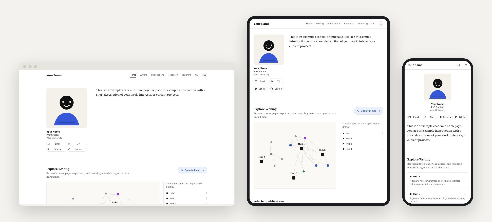
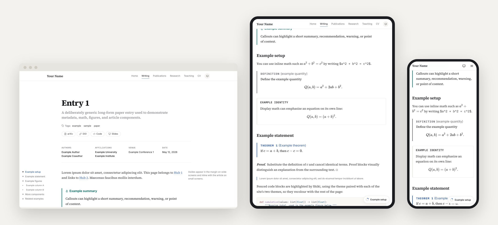

# Academic Graph Writing Template

A configurable Astro template for academic websites with a professional homepage,
conventional academic pages, a graph-structured writing corpus, and a
BibTeX-generated publications page.

The template is designed to stay static-first and sync-friendly:

- Reusable layout, feature, graph, validation, and build logic live in
  template-owned files.
- Site identity, content, data, and personal assets live in site-owned files.
- Downstream sites can keep this repository as an upstream remote and merge
  template improvements over time.

<picture>
  <source media="(prefers-color-scheme: dark)" srcset="docs/gallery/writing-map-dark.jpg">
  
</picture>

One design across desktop, tablet, and phone: the writing collection as a map,
topics, or a list behind one toolbar; articles with a contents sheet on narrow
screens; and a header that becomes an app bar on phones. More in the
[gallery](docs/gallery/README.md).

<p>
  
  
</p>

## Requirements

- Node `>=22.12.0`
- npm `>=10.8.2`

## Quickstart

```bash
npm install
npm run dev
```

Open the local URL printed by Astro. Useful routes:

- `/`
- `/writing`
- `/publications`
- `/research`
- `/teaching`
- `/about`

## Common Commands

```bash
npm run validate
npm run build
npm run preview
npm run test
npm run test:e2e
npm run lint
npm run new:entry
```

Create a writing entry:

```bash
npm run new:entry -- --type note --title "My New Note" --path learning/my-new-note
```

## Configuration

Template defaults live under `src/config/defaults/`. A website should customize
the template from the site-owned override file:

```txt
src/site/config.ts
```

Objects merge into the defaults. Arrays replace defaults, including `nav` and
`entryTypes`.

Writing corpus entry types are configured through a registry. Each type has an `id`, display
label, semantic role, graph styling, and article defaults. Roles drive template
behavior:

- `hub`: top-level topic entries shown as writing-map hubs.
- `section`: nested organizer entries, usually folder-owning.
- `entry`: ordinary notes, papers, posts, projects, or teaching material.

See [Configuration](docs/configuration.md) for the full model.

## Content

Site content lives in:

```txt
src/content/pages/
src/content/writing/
src/data/
public/
```

Writing entries use frontmatter links and `[[wikilinks]]` to build the graph.
Custom pages are outside the graph. Publications are generated from
`src/data/publications.bib`.

See [Using The Template](docs/using-the-template.md) for the content model and
authoring conventions.

## Adoption Workflows

There are two supported ways to create a site from this template:

- **Simple:** use GitHub's template button. This is best when you want a quick
  starting point and do not expect to merge many future template updates.
- **Sync-friendly:** preserve this repository's Git history as an upstream
  remote. This is best when you want your site repo to receive future template
  improvements with ordinary Git merges.

See [Using GitHub's Template Button](docs/using-github-template-button.md),
[Syncing With The Template](docs/syncing-with-template.md), and
[Migrating An Existing Site](docs/migrating-existing-site.md).

## Ownership Boundary

After adoption, downstream sites should usually edit only site-owned paths:

```txt
src/site/
src/content/
src/data/
public/profile.*
public/og-image.*
public/cv.pdf
public/site/
```

Generic layout and feature changes should be made in the template repository and
then merged into downstream sites. See [Repo Ownership](docs/repo-ownership.md).

## Deployment

This is a static Astro site. Build output goes to `dist/`:

```bash
npm run build
```

Vercel, Netlify, Cloudflare Pages, GitHub Pages, and generic static hosts can
serve the built output. For GitHub Pages, set `siteConfig.url` in
`src/site/config.ts` or the defaults to the final public URL.
