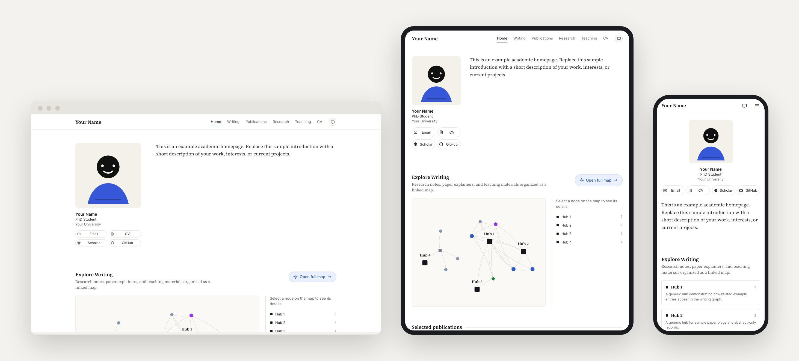
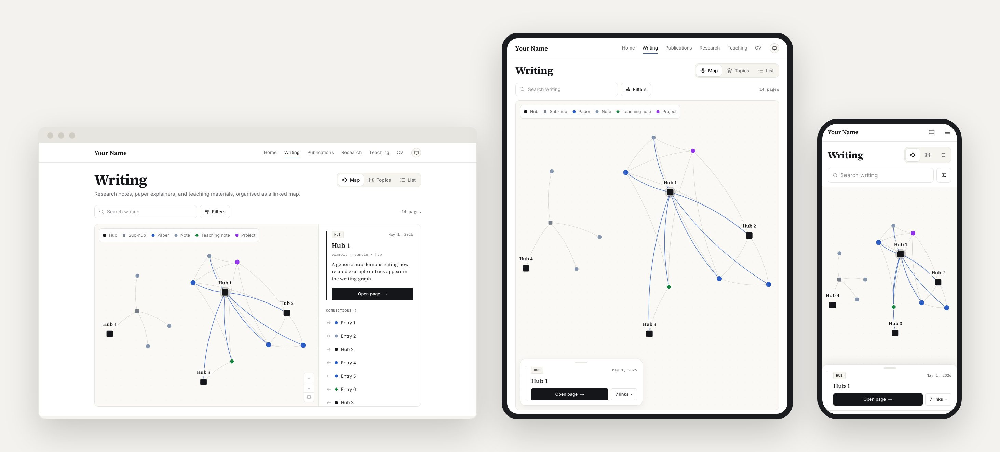
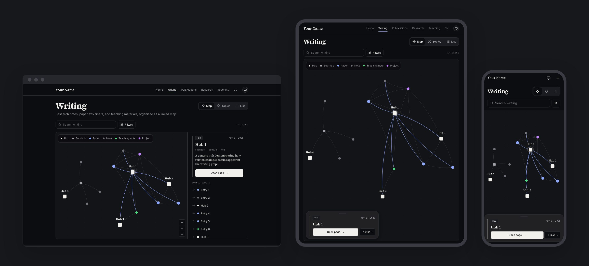
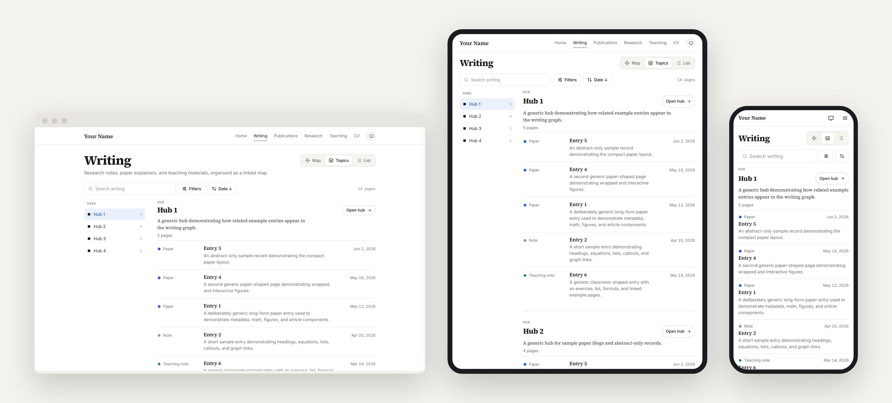
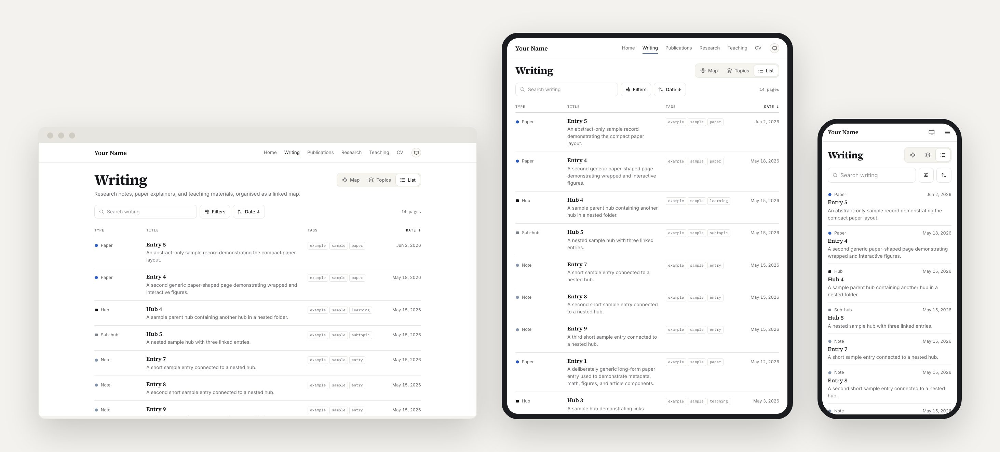
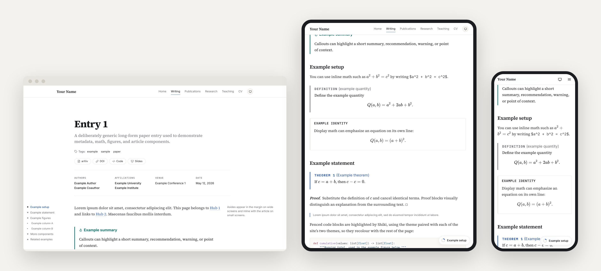
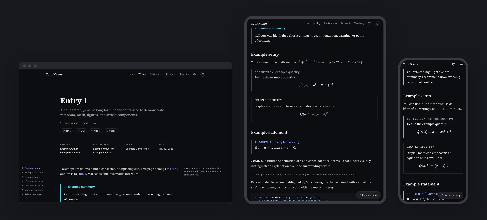
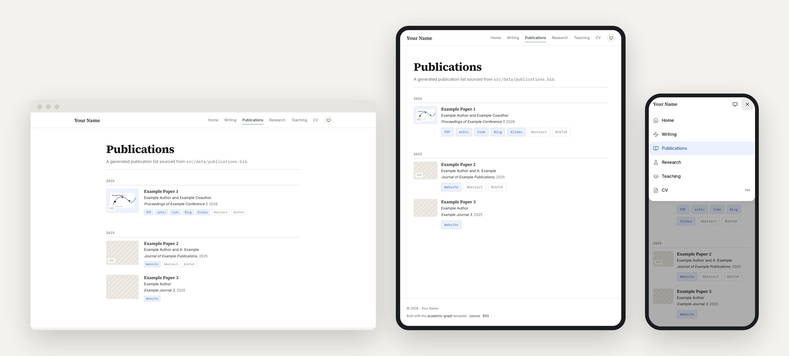

# Gallery

The template's example site at desktop (1280 × 800), tablet (820 × 1100), and
phone (393 × 852), drawn at one scale. Every image is a screenshot of the real
pages, framed by `scripts/gallery.ts`; regenerate them after a visual change:

```bash
npm run dev        # in another terminal
npm run gallery    # or: npm run gallery -- --url http://localhost:4322
```

## Homepage

The hero card beside the bio, then the writing map as a way in, with "Open full
map" beside the heading on wide screens and closing the section on a phone.



## Writing: map

One page for the whole writing collection. The map fills the screen with its
legend on the canvas; selecting a node opens the inspector, docked on desktop,
a floating card on tablet, a bottom sheet on a phone.





## Writing: topics

The hubs as a rail that follows the scroll, beside each hub's pages. The
toolbar (search, Filters, Sort) is the same in every view.



## Writing: list

Every page in one list, with sortable columns where there is room and stacked
rows on a phone. Rows lay themselves out by their own width.



## Articles

Long-form entries with math, theorems, figures, and code. On narrow screens
the contents ride in a pill that names the section being read and opens as a
sheet, and the phone's bar slides away while you read.





## Navigation

The header keeps every link inline while they fit on one line; otherwise, and
on any phone, it becomes an app bar whose menu lists each page with its icon.


